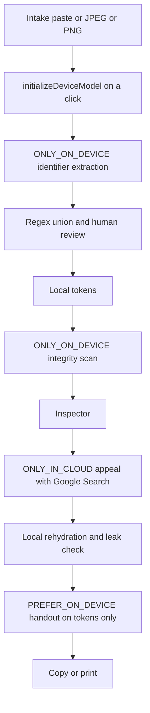

# AirlockMD

Cloud intelligence, local identity.

AirlockMD is a Chrome workspace for prior authorization and billing staff at small practices. Gemini Nano, through Firebase AI Logic, finds patient identifiers in a note or a JPEG/PNG referral and screens the document for hidden instructions. Cloud Gemini drafts a Search grounded appeal from the tokenized text only. The browser puts the real names back, then checks the cloud output for leaks.

Images are not uploaded. The token map stays in memory or in IndexedDB sealed with a session key. It is never written to Firestore.

This is a new app for the Firebase #BuildHybridAI 2026 hackathon. The Apache-2.0 `LICENSE` file was already in the repository. The application code was written for this submission. Every demo case is synthetic.

## What you need

- Node.js 20 or newer. Firebase JS SDK 13.4 prints an engine warning on Node 22. `npm install` and `npm run build` still complete. The app runs in Chrome, not in Node.
- Chrome Desktop 139 or newer for on-device Gemini Nano
- A Firebase project with AI Logic, App Check, Authentication, Cloud Firestore, Remote Config, and Hosting

On-device inference is optional for a first look. If Nano is missing, the airlock stays sealed: raw notes and images are not sent to the cloud. Synthetic fixtures still run through a local rehearsal (regex, instruction screen, tokens, inspector, local letter template). Judge mode is already tokenized, so a configured Firebase project can draft in the cloud without Nano.

## Chrome flags

On-device Gemini Nano uses the Chrome Prompt API. For local development, enable these flags, then restart Chrome:

- `chrome://flags/#prompt-api-for-gemini-nano-multimodal-input`
- In `chrome://flags`, search for "Gemma 4 for Built-in AI" and enable it

`initializeDeviceModel()` must run on a click, before the first prompt. Use **Enable on-device model** in the header. The download can take several minutes. The progress bar stays visible. `ONLY_ON_DEVICE` waits for that download. `PREFER_ON_DEVICE` does not, which is why identifier bearing text never uses prefer-on-device.

## Run locally

```bash
npm install
npm run dev
```

Open the printed local URL in Chrome. `npm test` runs the tokenizer, leak check, and rehydration tests. `npm run build` writes `dist/` for Hosting.

### Firebase config

Supply config in either place. Do not commit real values or debug tokens.

1. Copy `.env.example` to `.env.local` and fill in `VITE_FIREBASE_*`, plus `VITE_RECAPTCHA_SITE_KEY`.
2. Or copy `firebase-config.example.json` to `public/firebase-config.json` (gitignored) with the same fields.

| Value | Where it comes from |
| --- | --- |
| `apiKey` | Firebase web app config |
| `authDomain` | Firebase web app config |
| `projectId` | Firebase web app config |
| `storageBucket` | Firebase web app config |
| `messagingSenderId` | Firebase web app config |
| `appId` | Firebase web app config |
| `recaptchaSiteKey` | reCAPTCHA Enterprise or v3 |
| `VITE_RECAPTCHA_PROVIDER` | `enterprise` (default) or `v3` |
| `VITE_APPCHECK_DEBUG_TOKEN` | Local only. `true` prints a token to register, or paste a registered token. Never commit it. |

Set `.firebaserc` `default` to your project id before deploy. See [DEPLOY.md](DEPLOY.md).

Create a judge user in Authentication (email and password, or Google). Suggested email: `judge@airlockmd.example`. Put the password in the Devpost testing field, not in this repo.

## Architecture

```
[Clinician browser, Chrome 139+]
  Intake (paste or JPEG/PNG)
        |
        v
  initializeDeviceModel()  (user gesture, progress UI)
        |
        v
  ONLY_ON_DEVICE  identifier extraction + regex union
        |
        v
  Review and Release (human edits spans)
        |
        v
  Local tokenizer  (map stays in memory / session IndexedDB)
        |
        v
  ONLY_ON_DEVICE  integrity scan on tokenized + original untrusted text
        |                 (strip flagged instructions)
        v
  [Airlock Inspector shows exact outbound JSON]
        |
        |  fail closed if Nano missing for raw notes, or user has not released
        v
  ONLY_IN_CLOUD + Google Search grounding
        |  (tokenized summary only, App Check limited use tokens)
        v
  Local rehydration + leak check (regex + ONLY_ON_DEVICE)
        |
        v
  PREFER_ON_DEVICE handout on tokenized letter, then local rehydration
        |
        v
  Copy / print   +   Firestore audit (counts, sources, no identifiers)
```



Firebase AI Logic is imported from `firebase/ai` and called at runtime from `src/firebase/models.ts` and `src/state/useAirlock.ts` (`getAI`, `getGenerativeModel`, `initializeDeviceModel`, `generateContent`). No other model API is called. When Firebase config is absent, the rehearsal path is local code, not a second vendor.

## How the hybrid split works

Each mode is a trust boundary, not a convenience toggle.

| Step | Mode | Why |
| --- | --- | --- |
| Identifier extraction, image reading, integrity scan, leak check | `ONLY_ON_DEVICE` | Nano can see the note. If Nano is missing, this mode throws instead of falling back. The UI says the airlock is sealed and uses the local regex net for rehearsal. |
| Appeal | `ONLY_IN_CLOUD` plus Grounding with Google Search | Live payer policy is not available on device. The prompt is the tokenized JSON only. |
| Patient handout | `PREFER_ON_DEVICE` | The input is the tokenized letter. A cloud fallback is still safe. Names are filled in locally afterward. |

`PREFER_ON_DEVICE` is refused if the string still contains a known identifier or image data. That check runs in `assertSafeForCloudFallback` before the handout call and before the appeal call. Rehydrated text is never sent to a cloud capable mode.

Every real response shows `inferenceSource` as an `ON_DEVICE` or `IN_CLOUD` badge. Rehearsal steps are labeled `LOCAL REHEARSAL` so they are not mistaken for Nano.

Remote Config ships `phiCloudFallback=false`. If a project flips that flag, the app shows a warning and still refuses to send identifiers.

## Desk workflow

1. Open a synthetic case, paste a note, or drop a JPEG/PNG.
2. Click **Enable on-device model** when Chrome can run Nano.
3. **Find identifiers.** Review the highlights. Remove an over redaction if you want that text to remain, then confirm.
4. **Scan for hidden instructions.** A poisoned fax is flagged and stripped. It is not forwarded.
5. **Release to airlock.** The inspector shows the exact outbound JSON. Search the patient name. You should see 0 matches.
6. **Draft appeal.** With Firebase configured, this is `ONLY_IN_CLOUD` and shows citations plus Google Search suggestions when the response includes them. Without config, a local template keeps the tokens so the rest of the desk still runs.
7. **Restore names and check leaks.** The check looks at the cloud text before names return.
8. **Write patient handout.** Prefer on device, tokens only, then restore names locally.
9. Copy or print the restored letter.

Synthetic fixtures:

- Clean chart note (Avery Quinn)
- Referral PNG (Rowan Ellis)
- Poisoned fax PNG (Noor Adel), with a low contrast instruction line
- Judge mode (Samir Holt), already tokenized

Each fixture is labeled synthetic. Do not paste real records.

## Safety and limitations

AirlockMD is designed to keep raw identifiers on the device and to support a staff reviewed Safe Harbor style workflow. It is not a HIPAA compliance program, it is not certified, and this project does not claim a BAA with Google, Firebase, or Gemini.

Detection is defense in depth: a regex net, an on-device model when it is available, a person who releases the payload, and a leak check on the way back. It is not complete, not guaranteed, and not zero risk. Staff review is required.

The integrity scan is not immune to prompt injection. It is one screen for hidden instructions, and flagged lines are stripped from what can leave the device.

The app does not give clinical advice or coverage advice. A drafted appeal is for staff to edit. It does not mean a plan will approve the request.

Only the on-device stages can run without a network. The cloud draft is blocked while offline. The app does not claim to work fully offline.

The Firestore ledger stores a timestamp, step, mode, inference source, entity counts, whether an injection was blocked, the policy version, and a hash of the tokenized payload. It is an operations record. It is not a HIPAA audit log. Prompts, images, token maps, and letters are not written there.

No accuracy rate, time saved, or industry statistic is claimed here. All cases in the demo are synthetic.

## Project layout

- `src/firebase/models.ts` builds the four Firebase AI Logic modes
- `src/logic/` holds the tokenizer, leak check, rehydration, and safety gate
- `src/fixtures/cases.ts` holds the synthetic cases
- `public/fixtures/` holds the referral and poisoned fax images
- `docs/DEMO.md` is the three minute demo script
- `docs/DEVPOST.md` is the submission write up
- `DEPLOY.md` is the Hosting deploy

## License

Apache License 2.0. See `LICENSE`.
